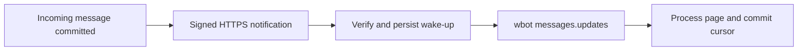

# Receive incoming-message wake-ups

Run `receiver.ts` with Bun and an installed wbot 0.2.5 or newer. It verifies the raw-body HMAC,
persists a wake-up in SQLite before acknowledging it, and drains `wbot messages.updates` with a
saved cursor. The example stores only message IDs/revisions. Replace that demonstration processing
with your own durable business transaction or outbox before using it for customer work.



## Setup

Use a Tenant API Key with a read grant for the intended conversation. Set `WBOT_API_KEY`,
`WBOT_CONVERSATION_ID`, and `WBOT_WEBHOOK_SIGNING_SECRET` in your secret manager or environment.
The signing secret is a separate random 32-byte base64url value; generate it with
`openssl rand -base64 32 | tr '+/' '-_' | tr -d '=\n'` in a private terminal, and save it securely.
Use the same value for the receiver and subscription, and retain it when retrying configuration.

```sh
bun run examples/webhook/receiver.ts
```

The example binds `127.0.0.1:8787`. Put it behind your own HTTPS reverse proxy and expose only
`POST /webhook`; the Platform requires a public IPv4 DNS hostname on HTTPS port 443 and does not
follow redirects. Configure your process supervisor to restart the receiver after a crash.
`WBOT_WEBHOOK_DB` selects a durable SQLite file (default `webhook.sqlite`); use a separate database
per conversation, preserve it across restarts, and never commit it. `WBOT_BIN` can select an absolute
path to an installed wbot executable. `PORT` changes the local port.

The receiver bootstraps and saves its cursor at startup. Once that succeeds, configure the URL:

```sh
wbot webhooks.configure '{"conversationId":"YOUR_CONVERSATION_ID","url":"https://hooks.your-domain.com/webhook"}'
wbot webhooks.list
```

Restart the receiver once after registration to reconcile from the saved cursor and cover the setup
gap. Thereafter webhook wake-ups start drains immediately. Failed drains retry after 30 seconds;
there is no idle polling loop. Startup always reconciles, including after a crash between operations.

For Test use `WBOT_PLATFORM_URL=https://wbot-api-test.celados.com` consistently for both configuration
and receiver processes. Production is the CLI default. Keys, grants and cursors belong to one
environment and cannot be mixed.

## Notification and recovery contract

The payload contains `version: 1`, `type: "messages.available"`, `eventId`, `conversationId`, and
`createdAtMs`. It carries no message bodies or consumption cursor. The HMAC-SHA256 is over
`timestamp + '.' + rawBody`; headers are `Switchboard-Timestamp` (Unix seconds),
`Switchboard-Signature` (`v1=<hex>`), and `Switchboard-Event-Id`. Reject timestamps more than five
minutes away and preserve the exact raw bytes for verification. `verify.ts` implements these checks.

One event may represent multiple messages. Notifications may duplicate or arrive out of order.
Serialize consumption per conversation, merge message ID/revision, and advance `nextCursor` only
with durable processing of that page. A 2xx response accepts the wake-up; it does not prove business
processing. This example remembers event IDs for seven days and stores latest projection revisions.
It still reconciles on duplicate wake-ups, which is safe because cursor/projection processing is
idempotent. `messages.updates` is the CLI name for the Platform `messages.query` operation.

Only **incoming new messages** trigger notifications. Updates can still return outgoing messages
and retractions; auto-reply integrations must filter direction. Quiet retractions and attachment
readiness do not trigger wake-ups. Reconcile on startup and, if your application needs those quiet
changes, use an application-owned periodic reconciliation schedule.

The Platform retries network failures and HTTP 408/429/5xx with exponential backoff from one minute,
capped at one hour, eight attempts and a 24-hour event lifetime. Other non-2xx responses fail without
automatic retry. This is bounded at-least-once notification, not guaranteed indefinite delivery.
Inspect `deliveryStatus`, `attempts`, `lastError` and `lastDeliveredAtMs` with `webhooks.list`.

```sh
wbot webhooks.retry '{"conversationId":"YOUR_CONVERSATION_ID"}'
wbot webhooks.remove '{"conversationId":"YOUR_CONVERSATION_ID"}'
```

Retry restarts failed/cancelled work. Removing stops future scheduling; an already dispatched request
may still arrive. Grant revocation prevents new authorized delivery and queries. Restoring access
requires explicit cursor reconciliation for messages that arrived while notifications were blocked.

Subscription limits are 20 per tenant and 100 per conversation, with one URL per tenant/conversation.
Identical configure calls preserve work; changing URL or secret fences old attempts and re-notifies
pending work. Neither configuration nor delivery status records the caller's consumption progress.
