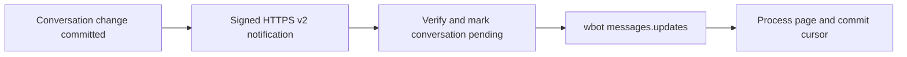

# Receive conversation wake-ups

Run `receiver.ts` with Bun and an installed `wbot` 0.4.0-rc.4 or newer. It verifies the raw-body
HMAC on `/platform/v2` webhook deliveries, persists per-conversation checkpoints in a single SQLite
database before acknowledging wake-ups, and drains `wbot messages.updates` per conversation. Without
a saved cursor for a conversation, `messages.updates` returns no items and a tail cursor, so the
first drain bootstraps that conversation. The example stores only message IDs and revisions; replace
that demonstration processing with your own durable business transaction or outbox before using it
for customer work.



## Setup

Use a Tenant API Key with `read` grants for the conversations you want to observe. Set
`WBOT_API_KEY` and `WBOT_WEBHOOK_SIGNING_SECRET` in your secret manager or environment. Optionally
set `WBOT_CONVERSATION_IDS` (comma-separated) to bootstrap cursors for known conversations at
startup before the first webhook arrives.

The signing secret is a separate random 32-byte base64url value; generate it with
`openssl rand -base64 32 | tr '+/' '-_' | tr -d '=\n'` in a private terminal, and save it securely.
Use the same value for the receiver and webhook endpoint.

```sh
bun run examples/webhook/receiver.ts
```

The example binds `127.0.0.1:8787`. Put it behind your own HTTPS reverse proxy and expose only
`POST /webhook`; the Platform requires a public HTTPS hostname on port 443, enforces public-network
egress, and does not follow redirects. Configure your process supervisor to restart the receiver
after a crash. `WBOT_WEBHOOK_DB` selects a durable SQLite file (default `webhook.sqlite`); it tracks
all conversations in its `checkpoints` table — preserve it across restarts and never commit it.
`WBOT_BIN` can select an absolute path to an installed `wbot` executable. `PORT` changes the local
port.

Once the receiver is running, create a webhook endpoint (all readable conversations by default, or
pass `"conversationIds": [...]` to filter):

```sh
wbot webhooks.create '{"url":"https://hooks.your-domain.com/webhook"}'
wbot webhooks.list
```

Restart the receiver once after registration (with `WBOT_CONVERSATION_IDS` set if you want
immediate bootstrap for specific conversations) to reconcile from saved cursors and cover any setup
gap. Thereafter webhook wake-ups start per-conversation drains immediately. Failed drains retry
after 30 seconds; there is no idle polling loop. Startup always reconciles every persisted
checkpoint, including after a crash between operations.

The CLI default is `https://wbot-api-test.celados.com`. If you override `WBOT_PLATFORM_URL`, use the
same value for both webhook management and receiver processes. Keys, grants, and cursors belong to
one environment and cannot be mixed.

## Notification and recovery contract

The payload is identical to `GET /platform/v2/events` (SSE): `version: 2`,
`type: "conversation.updated"`, `eventId`, `conversationId`, `reasons` (non-empty deduplicated
subset of `"message"`, `"retraction"`, `"attachment"`), and `createdAtMs`. It carries no message
bodies or consumption cursor.

The HMAC-SHA256 is computed over `${timestamp}.${rawBody}`; headers are `Switchboard-Timestamp`
(Unix seconds), `Switchboard-Signature` (`v1=<hex>`), `Switchboard-Event-Id`, and
`User-Agent: Switchboard-Webhook/2`. Reject timestamps more than five minutes away and preserve the
exact raw bytes for verification. `verify.ts` implements these checks.

One event may represent multiple changes (`message`, `retraction`, `attachment`). Notifications may
duplicate or arrive out of order. Serialize consumption per conversation, merge by message `id` and
highest `revision`, and advance `nextCursor` only with durable processing of that page. A 2xx
response accepts the wake-up; it does not prove business processing. This example remembers event IDs
for seven days and stores latest projection revisions. It still reconciles on duplicate wake-ups,
which is safe because cursor and projection processing is idempotent.

All three change reasons trigger notifications, and `messages.updates` can include outgoing messages
as well as incoming ones, so auto-reply integrations must still filter `message.direction`.

The Platform retries network failures and HTTP 408/429/5xx with exponential backoff from one minute,
capped at one hour, eight attempts and a 24-hour event lifetime, keeping the exact `eventId` and
JSON body byte-identical across retries while coalescing newer changes into a follow-up delivery on
2xx. Other non-2xx responses fail without automatic retry. This is bounded at-least-once
notification, not guaranteed indefinite delivery. Inspect endpoint health with `webhooks.list` and
per-conversation delivery states with `webhooks.get`:

```sh
wbot webhooks.get '{"webhookId":"YOUR_WEBHOOK_ID"}'
wbot webhooks.update '{"webhookId":"YOUR_WEBHOOK_ID","status":"disabled"}'
wbot webhooks.retry '{"webhookId":"YOUR_WEBHOOK_ID"}'
wbot webhooks.delete '{"webhookId":"YOUR_WEBHOOK_ID"}'
```

`webhooks.retry` requeues `failed` or `cancelled` deliveries (optionally for one `conversationId`).
`webhooks.delete` removes the endpoint and stops future scheduling; an already dispatched request
may still arrive. Grant revocation cancels delivery at dispatch time (`Read access revoked`).
Restoring access requires explicit cursor reconciliation for changes that arrived while
notifications were blocked.

Limits are 5 endpoints per tenant and up to 100 explicit `conversationIds` per endpoint. Changing
`url` or rotating `signingSecret` (`"rotateSecret": true`) fences in-flight attempts from prior
generations and re-notifies pending work. Neither endpoint configuration nor delivery state records
the caller's consumption progress.
